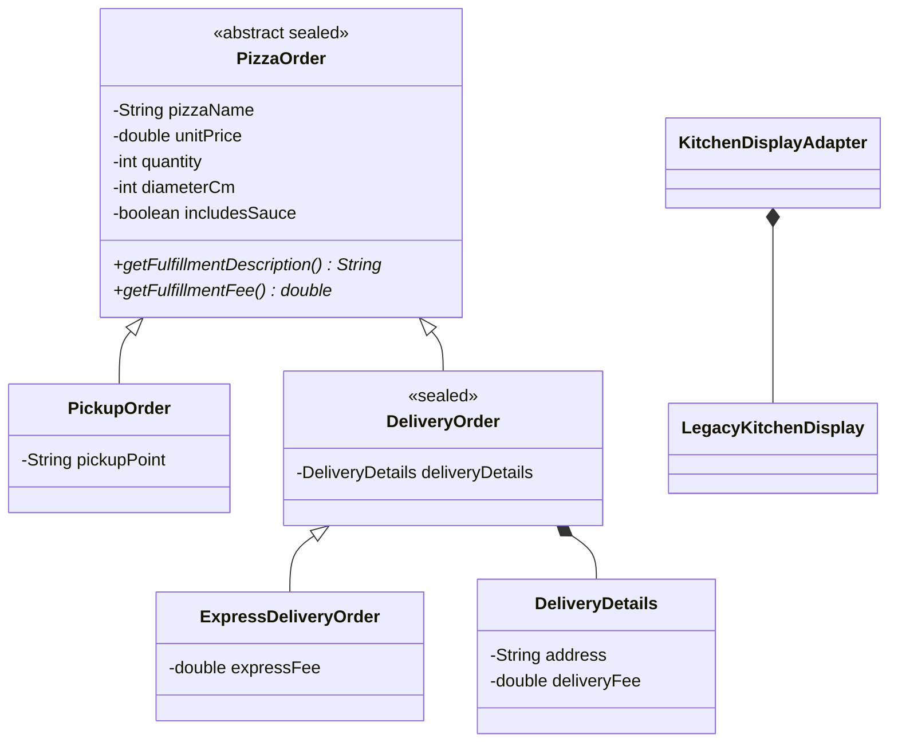

# Лабораторна робота №1: Консольний застосунок на Java

Предметна область: електронне меню піцерії.

## Опис сутностей

- Піца: назва (`String`), ціна за одиницю (`double`), діаметр у см (`int`).
- Замовлення: кількість штук (`int`), наявність додаткового соусу (`boolean`).

## Обчислювальна операція

- Додатковий соус: якщо `includesSauce == true`, додається 25 грн за кожну піцу.
- Знижка 15% надається при замовленні від 3 піц або загальній сумі від 600 грн.
- Знижка 5% надається при замовленні 2 піц.

## Інструкція запуску

```bash
javac *.java
java Main
```

## Лабораторна робота №2: Опрацювання масивів із застосуванням циклів

Клас `PizzaOrder` моделює замовлення піци: назву, ціну за одиницю, кількість, діаметр і наявність додаткового соусу. Для кожного замовлення обчислюється сума з урахуванням соусу та знижки.

Програма заповнює масив замовлень із клавіатури, виводить його циклом for-each, рахує замовлення з ціною нижче вказаного порога, сортує за ціною методом bubble sort і виконує лінійний пошук за всіма полями об'єкта.

### Запуск ЛР2

```bash
javac *.java
java Main
```

Введіть кількість замовлень, дані кожного замовлення, поріг ціни та всі поля замовлення для перевірки пошуку. Для соусу введіть `true` або `false`.

## Лабораторна робота №3: Обробка винятків

Класи розміщені в окремих файлах: `Main.java` відповідає за консольний сценарій, `PizzaOrder.java` — за модель замовлення, а `DomainException.java`, `InvalidPriceException.java` та `InvalidQuantityException.java` — за ієрархію доменних винятків.

Клас `PizzaOrder` перевіряє, що ціна є додатною та скінченною, а кількість піц — більшою за нуль. Для порушень створені винятки `InvalidPriceException` та `InvalidQuantityException`, що успадковуються від `DomainException` і зберігають некоректне значення.

Помилки введення обробляються окремими `catch`-блоками. `readOrder` частково обробляє доменний виняток і повторно кидає його для обробки в `main`; `finally` виводить повідомлення про завершення, а `Scanner` закривається через try-with-resources.

### Запуск ЛР3

```bash
javac *.java
java Main
```

Введіть дані замовлення у відповідь на підказки. Якщо введено текст замість числа, від'ємну/нульову кількість або недопустиму ціну, програма виведе відповідне повідомлення.

## Лабораторна робота №4: Інтерфейси та патерн Strategy

Для замовлень піцерії поведінку розрахунку вартості винесено в інтерфейс `OrderPricingStrategy`. `StandardOrderPricingStrategy` зберігає звичні правила знижок, а `HappyHourPricingStrategy` застосовує знижку 10%. Масив стратегій демонструє поліморфне виконання; `OrderCheckout` приймає стратегію та дозволяє змінити її під час роботи програми.

`AbstractOrderPricingStrategy` частково реалізує контракт і надає спільні методи обчислення суми та знижки. `HappyHourPricingStrategy` додатково реалізує інтерфейс `PromotionDescription`, щоб окремо надавати опис акції. У `OrderPricingStrategy` є default-метод із назвою за замовчуванням. Виведення замовлення використовує стандартну стратегію, тому раніше визначені правила ціни та знижок збережені.

### Запуск ЛР4

```bash
javac *.java
java Main
```

Після введення замовлень програма покаже суму за обома стратегіями, опис акції та зміну стратегії в контексті `OrderCheckout`.

## Лабораторна робота №5: GoF-патерни Factory Method, Observer та Adapter

Рефакторинг продовжує проєкт електронного меню піцерії з ЛР №1–4:

- `OrderPricingStrategyFactory` створює стандартну або акційну стратегію за кодом. Клієнтський код і `PizzaOrder` більше не створюють конкретні стратегії безпосередньо; новий тип стратегії підключається в одному місці.
- `PizzaOrder` є суб'єктом Observer: при зміні статусу він повідомляє підписані `OrderStatusListener`. У демонстрації на одне замовлення підписані журнал (`OrderStatusLogger`) і кухонний дисплей.
- `KitchenDisplayAdapter` адаптує події очікуваного інтерфейсу `OrderStatusListener` до API `LegacyKitchenDisplay`, який приймає назву замовлення і текст статусу окремими аргументами. Несумісний клас не змінюється; його можна замінити зовнішньою системою дисплея без змін моделі замовлення.

Це саме Adapter, оскільки він реалізує інтерфейс, потрібний системі замовлень, і делегує виклик іншому API, перетворюючи аргументи події. Переписування класу дисплея змінило б його API та змусило б залежний код знати про несумісну реалізацію.

### Запуск ЛР5

```bash
javac *.java
java Main
```

Після введення замовлень програма покаже створення стратегій через фабрику та два послідовні переходи статусу, кожен з яких відображається у журналі й на адаптованому кухонному дисплеї.

## Лабораторна робота №6: Наслідування та поліморфізм

Модель замовлення розширено за предметною областю: замовлення може бути самовивозом, звичайною доставкою або експрес-доставкою. Це відношення «is-a»: `PickupOrder` і `DeliveryOrder` є різновидами `PizzaOrder`, а `ExpressDeliveryOrder` є різновидом `DeliveryOrder`. Створювати загальне замовлення без способу отримання не має змісту, тому `PizzaOrder` — абстрактний клас із приватними спільними полями, абстрактними методами опису отримання та його вартості.



`PizzaOrder` запечатаний (`sealed`) і дозволяє лише `PickupOrder` та `DeliveryOrder`; останній теж запечатаний і дозволяє лише `ExpressDeliveryOrder`. Це дає компілятору змогу перевірити повноту pattern `switch` для всіх конкретних різновидів замовлення. Цикл за `PizzaOrder[]` викликає перевизначений опис отримання, а `instanceof` з pattern matching демонструє доступ до адреси через базове посилання. Його оголошений тип — `PizzaOrder`, динамічний тип під час виконання — фактичний клас об'єкта, наприклад `ExpressDeliveryOrder`.

Конструктори підкласів делегують спільну ініціалізацію через `super(...)`; короткий конструктор `PickupOrder` делегує повному через `this(...)`. Повідомлення конструкторів ідуть від предка до нащадка (`PizzaOrder` → `DeliveryOrder` → `ExpressDeliveryOrder`), а повернення з конструктора, що делегував через `this(...)`, відбувається після конструктора-цілі. Діаметр, назва, кількість і поля вартості приватні; `PizzaOrder` є базою абстрактного класу й не має публічних mutable-полів.

Для `equals()` обрано `getClass()`, а не `instanceof` у базовій перевірці: об'єкти різних підтипів замовлення не рівні, навіть якщо збігаються спільні поля. Підклас додає власні поля до рівності та `hashCode()`. Тому порівняння `PickupOrder` із `DeliveryOrder` дає `false` в обох напрямках — симетрія збережена. Використання лише `instanceof PizzaOrder` у базовому `equals()` могло б дати асиметрію, якщо підклас додає значущі поля.

Композиція доречна для `DeliveryOrder` і `DeliveryDetails`: доставка **має** адресу та тариф, але доставка не **є** адресою. Наслідування від `DeliveryDetails` підмінило б сутність замовлення адресою і не дозволило б коректно моделювати кілька незалежних від замовлення значень доставки. `KitchenDisplayAdapter` так само **має** `LegacyKitchenDisplay` і делегує йому виведення; адаптер не є дисплеєм. `ExpressDeliveryOrder` перевизначає поведінку доставки та додає власну доплату. Конструктори й методи не допускають змінення стану через публічні поля; клас `PickupOrder` і leaf-клас `ExpressDeliveryOrder` оголошені `final`, оскільки додаткове наслідування від них у цій моделі не передбачене.

### Запуск ЛР6

Потрібен JDK 21 або новіший для `sealed`-класів і pattern matching у `switch`.

```bash
javac *.java
java Main
```

Під час введення замовлення виберіть спосіб отримання: `1` — самовивіз, `2` — доставка або `3` — експрес-доставка. Для доставки введіть адресу й тариф; для експрес-доставки також введіть доплату. Вартість доставки додається до суми до застосування знижки. Ланцюжок конструкторів, поліморфний опис, доступ до специфічного методу та порівняння об'єктів різних підтипів демонструються в консолі.
