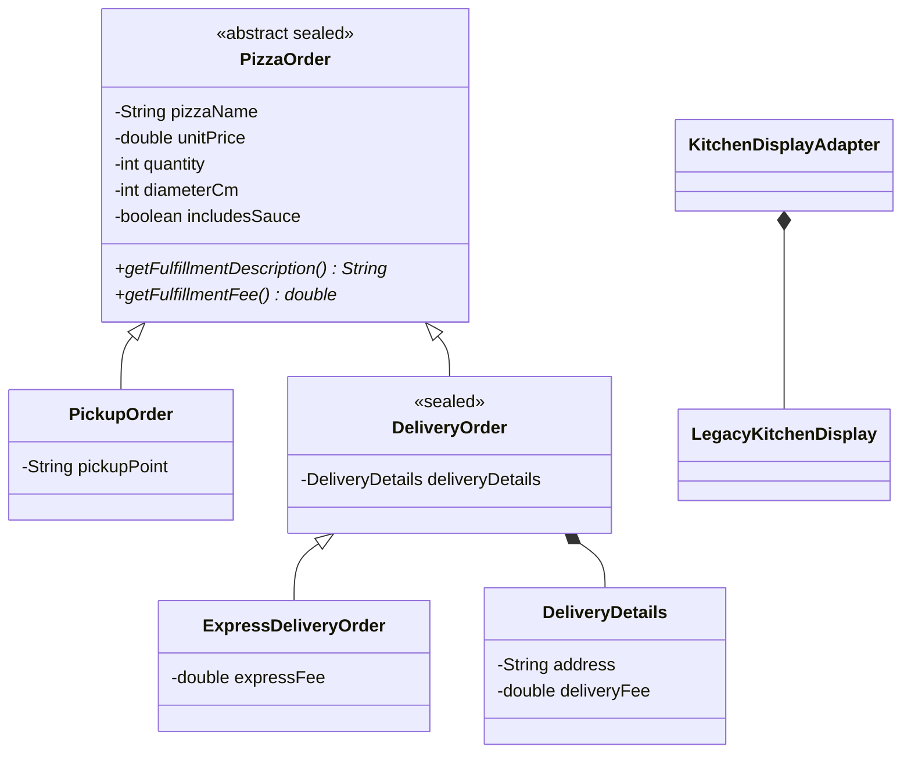
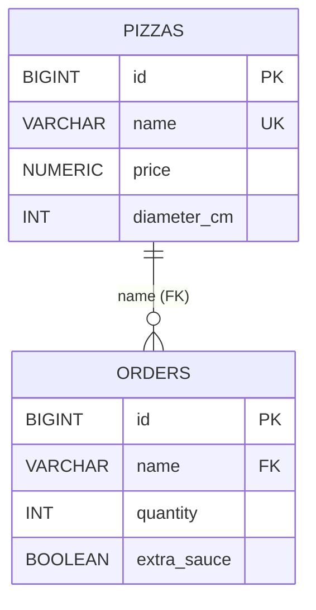

# Лабораторна робота №1: Консольний застосунок на Java

Предметна область: електронне меню піцерії.

## Опис сутностей

- Піца: назва (`String`), ціна за одиницю (`double`), діаметр у см (`int`).
- Замовлення: кількість штук (`int`), наявність додаткового соусу (`boolean`).

## Обчислювальна операція

- Додатковий соус: якщо `includesSauce == true`, додається 25 грн за кожну піцу.
- Знижка 15% надається при замовленні від 3 піц або загальній сумі від 600 грн.
- Знижка 5% надається при замовленні 2 піц.

## Інструкція запуску

```bash
mvn compile
mvn exec:java -Dexec.mainClass=ua.edu.pizzeria.Main
```

## Лабораторна робота №2: Опрацювання масивів із застосуванням циклів

Клас `PizzaOrder` моделює замовлення піци: назву, ціну за одиницю, кількість, діаметр і наявність додаткового соусу. Для кожного замовлення обчислюється сума з урахуванням соусу та знижки.

Програма заповнює масив замовлень із клавіатури, виводить його циклом for-each, рахує замовлення з ціною нижче вказаного порога, сортує за ціною методом bubble sort і виконує лінійний пошук за всіма полями об'єкта.

### Запуск ЛР2

```bash
mvn compile
mvn exec:java -Dexec.mainClass=ua.edu.pizzeria.Main
```

Введіть кількість замовлень, дані кожного замовлення, поріг ціни та всі поля замовлення для перевірки пошуку. Для соусу введіть `true` або `false`.

## Лабораторна робота №3: Обробка винятків

Класи розміщені в окремих файлах: `Main.java` відповідає за консольний сценарій, `PizzaOrder.java` — за модель замовлення, а `DomainException.java`, `InvalidPriceException.java` та `InvalidQuantityException.java` — за ієрархію доменних винятків.

Клас `PizzaOrder` перевіряє, що ціна є додатною та скінченною, а кількість піц — більшою за нуль. Для порушень створені винятки `InvalidPriceException` та `InvalidQuantityException`, що успадковуються від `DomainException` і зберігають некоректне значення.

Помилки введення обробляються окремими `catch`-блоками. `readOrder` частково обробляє доменний виняток і повторно кидає його для обробки в `main`; `finally` виводить повідомлення про завершення, а `Scanner` закривається через try-with-resources.

### Запуск ЛР3

```bash
mvn compile
mvn exec:java -Dexec.mainClass=ua.edu.pizzeria.Main
```

Введіть дані замовлення у відповідь на підказки. Якщо введено текст замість числа, від'ємну/нульову кількість або недопустиму ціну, програма виведе відповідне повідомлення.

## Лабораторна робота №4: Інтерфейси та патерн Strategy

Для замовлень піцерії поведінку розрахунку вартості винесено в інтерфейс `OrderPricingStrategy`. `StandardOrderPricingStrategy` зберігає звичні правила знижок, а `HappyHourPricingStrategy` застосовує знижку 10%. Масив стратегій демонструє поліморфне виконання; `OrderCheckout` приймає стратегію та дозволяє змінити її під час роботи програми.

`AbstractOrderPricingStrategy` частково реалізує контракт і надає спільні методи обчислення суми та знижки. `HappyHourPricingStrategy` додатково реалізує інтерфейс `PromotionDescription`, щоб окремо надавати опис акції. У `OrderPricingStrategy` є default-метод із назвою за замовчуванням. Виведення замовлення використовує стандартну стратегію, тому раніше визначені правила ціни та знижок збережені.

### Запуск ЛР4

```bash
mvn compile
mvn exec:java -Dexec.mainClass=ua.edu.pizzeria.Main
```

Після введення замовлень програма покаже суму за обома стратегіями, опис акції та зміну стратегії в контексті `OrderCheckout`.

## Лабораторна робота №5: GoF-патерни Factory Method, Observer та Adapter

Рефакторинг продовжує проєкт електронного меню піцерії з ЛР №1–4:

- `OrderPricingStrategyFactory` створює стандартну або акційну стратегію за кодом. Клієнтський код і `PizzaOrder` більше не створюють конкретні стратегії безпосередньо; новий тип стратегії підключається в одному місці.
- `PizzaOrder` є суб'єктом Observer: при зміні статусу він повідомляє підписані `OrderStatusListener`. У демонстрації на одне замовлення підписані журнал (`OrderStatusLogger`) і кухонний дисплей.
- `KitchenDisplayAdapter` адаптує події очікуваного інтерфейсу `OrderStatusListener` до API `LegacyKitchenDisplay`, який приймає назву замовлення і текст статусу окремими аргументами. Несумісний клас не змінюється; його можна замінити зовнішньою системою дисплея без змін моделі замовлення.

Це саме Adapter, оскільки він реалізує інтерфейс, потрібний системі замовлень, і делегує виклик іншому API, перетворюючи аргументи події. Переписування класу дисплея змінило б його API та змусило б залежний код знати про несумісну реалізацію.

### Запуск ЛР5

```bash
mvn compile
mvn exec:java -Dexec.mainClass=ua.edu.pizzeria.Main
```

Після введення замовлень програма покаже створення стратегій через фабрику та два послідовні переходи статусу, кожен з яких відображається у журналі й на адаптованому кухонному дисплеї.

## Лабораторна робота №6: Наслідування та поліморфізм

Модель замовлення розширено за предметною областю: замовлення може бути самовивозом, звичайною доставкою або експрес-доставкою. Це відношення «is-a»: `PickupOrder` і `DeliveryOrder` є різновидами `PizzaOrder`, а `ExpressDeliveryOrder` є різновидом `DeliveryOrder`. Створювати загальне замовлення без способу отримання не має змісту, тому `PizzaOrder` — абстрактний клас із приватними спільними полями, абстрактними методами опису отримання та його вартості.



`PizzaOrder` запечатаний (`sealed`) і дозволяє лише `PickupOrder` та `DeliveryOrder`; останній теж запечатаний і дозволяє лише `ExpressDeliveryOrder`. Це дає компілятору змогу перевірити повноту pattern `switch` для всіх конкретних різновидів замовлення. Цикл за `PizzaOrder[]` викликає перевизначений опис отримання, а `instanceof` з pattern matching демонструє доступ до адреси через базове посилання. Його оголошений тип — `PizzaOrder`, динамічний тип під час виконання — фактичний клас об'єкта, наприклад `ExpressDeliveryOrder`.

Конструктори підкласів делегують спільну ініціалізацію через `super(...)`; короткий конструктор `PickupOrder` делегує повному через `this(...)`. Повідомлення конструкторів ідуть від предка до нащадка (`PizzaOrder` → `DeliveryOrder` → `ExpressDeliveryOrder`), а повернення з конструктора, що делегував через `this(...)`, відбувається після конструктора-цілі. Діаметр, назва, кількість і поля вартості приватні; `PizzaOrder` є базою абстрактного класу й не має публічних mutable-полів.

Для `equals()` обрано `getClass()`, а не `instanceof` у базовій перевірці: об'єкти різних підтипів замовлення не рівні, навіть якщо збігаються спільні поля. Підклас додає власні поля до рівності та `hashCode()`. Тому порівняння `PickupOrder` із `DeliveryOrder` дає `false` в обох напрямках — симетрія збережена. Використання лише `instanceof PizzaOrder` у базовому `equals()` могло б дати асиметрію, якщо підклас додає значущі поля.

Композиція доречна для `DeliveryOrder` і `DeliveryDetails`: доставка **має** адресу та тариф, але доставка не **є** адресою. Наслідування від `DeliveryDetails` підмінило б сутність замовлення адресою і не дозволило б коректно моделювати кілька незалежних від замовлення значень доставки. `KitchenDisplayAdapter` так само **має** `LegacyKitchenDisplay` і делегує йому виведення; адаптер не є дисплеєм. `ExpressDeliveryOrder` перевизначає поведінку доставки та додає власну доплату. Конструктори й методи не допускають змінення стану через публічні поля; клас `PickupOrder` і leaf-клас `ExpressDeliveryOrder` оголошені `final`, оскільки додаткове наслідування від них у цій моделі не передбачене.

### Запуск ЛР6

Потрібен JDK 21 або новіший для `sealed`-класів і pattern matching у `switch`.

```bash
mvn compile
mvn exec:java -Dexec.mainClass=ua.edu.pizzeria.Main
```

Під час введення замовлення виберіть спосіб отримання: `1` — самовивіз, `2` — доставка або `3` — експрес-доставка. Для доставки введіть адресу й тариф; для експрес-доставки також введіть доплату. Вартість доставки додається до суми до застосування знижки. Ланцюжок конструкторів, поліморфний опис, доступ до специфічного методу та порівняння об'єктів різних підтипів демонструються в консолі.

# Лабораторна робота №10: Maven як інструмент побудови проєкту. JDBC

Гілка: **`lr10/maven-jdbc`**. Pull Request створюється в `main` і **не зливається**.

Проєкт ЛР №1–9 перетворено на Maven-проєкт зі стандартною структурою. Усі попередні класи та консольний сценарій збережені, але тепер вони лежать у пакеті `ua.edu.pizzeria` і збираються Maven. Сховище в пам'яті не видалене: `InMemoryPizzaService` і надалі працює, а поруч з'явилася JDBC-реалізація тих самих інтерфейсів.

## Структура проєкту

```text
pizzeria-system/
├── pom.xml
├── src/main/java/ua/edu/pizzeria/      # усі класи ЛР №1–10
├── src/main/resources/
│   ├── application.properties           # URL, користувач, пароль, налаштування пулу
│   └── init.sql                         # DDL + ідемпотентні стартові дані
├── data/                                # файли H2 (створюються під час запуску, у .gitignore)
└── README.md
```

Основні нові класи:

| Клас | Призначення |
|---|---|
| `DBConnection` | Singleton, що тримає `HikariDataSource` (пул з'єднань) |
| `DatabaseInitializer` | автоматично виконує `init.sql` при старті |
| `JdbcPizzaService` | JDBC-реалізація `PizzaService` (рівень 1) |
| `AbstractJdbcCrudService<T>` | спільна JDBC-логіка за Template Method (рівень 3) |
| `JdbcOrderService` | друга сутність через `AbstractJdbcCrudService` |
| `JdbcOrderPlacementService` | транзакція на дві таблиці з `commit`/`rollback` |
| `JdbcBatchDemo` | вимірювання одиночної та пакетної вставки |
| `JdbcDemo` | точка входу для демонстрації ЛР №10 |

## Сутності та схема БД

Обрано **H2 у файловому режимі** (`jdbc:h2:file:./data/pizzeria`): не потрібно встановлювати окремий сервер БД, а дані зберігаються між запусками. За бажанням URL можна змінити на PostgreSQL у `application.properties`.



| Таблиця | Поле | Обмеження |
|---|---|---|
| `pizzas` | `id` | `PRIMARY KEY` |
| `pizzas` | `name` | `NOT NULL`, `UNIQUE` (назва піци в меню унікальна) |
| `pizzas` | `price` | `NUMERIC(10,2)`, `CHECK (price > 0)` — гроші не зберігаються як `FLOAT` |
| `pizzas` | `diameter_cm` | `NOT NULL`, `CHECK (diameter_cm > 0)` |
| `orders` | `id` | `PRIMARY KEY` |
| `orders` | `name` | `NOT NULL`, `FOREIGN KEY -> pizzas(name)` |
| `orders` | `quantity` | `NOT NULL`, `CHECK (quantity > 0)` |
| `orders` | `extra_sauce` | `NOT NULL` |

Зв'язок «один до багатьох»: одна піца з меню може бути в багатьох замовленнях. У наявній моделі `Order` немає окремого `pizzaId`, тому назва піци виступає природним зовнішнім ключем. Це дозволило **не змінювати** ні `Order`, ні інтерфейси сервісів.

**`ON DELETE RESTRICT`** обрано свідомо: не можна видалити піцу з меню, поки на неї посилаються замовлення. Інакше історія замовлень втратила б сенс, а рядки `orders` стали б «сиротами». Якщо піцу треба прибрати, спочатку переносять або видаляють її замовлення. `ON UPDATE CASCADE` дозволяє перейменувати піцу, не ламаючи зв'язки.

## Запуск з нуля

Потрібні **JDK 21+** і **Maven 3.9+**. Окремо встановлювати H2 не потрібно: драйвер підтягується Maven-ом.

```bash
# 1. Зібрати проєкт
mvn compile

# 2. Запустити демонстрацію ЛР №10 (JdbcDemo — основна точка входу)
mvn exec:java

# 3. Запустити старий інтерактивний сценарій ЛР №1–6
mvn exec:java -Dexec.mainClass=ua.edu.pizzeria.Main

# 4. Зібрати виконуваний jar разом із залежностями
mvn package
java -jar target/pizzeria-system-1.0.0.jar
```

Якщо Maven не встановлений глобально, у репозиторії є Maven Wrapper: замініть `mvn` на `./mvnw` (Linux/macOS) або `mvnw.cmd` (Windows). Наприклад:

```bash
./mvnw compile
./mvnw exec:java
```

Під час першого запуску H2 сама створює файл `data/pizzeria.mv.db`, а `DatabaseInitializer` виконує `init.sql`. Щоб почати з чистої БД, зупиніть програму й видаліть каталог `data/`.

Параметри підключення не зашиті в код і знаходяться у `src/main/resources/application.properties`:

```properties
db.url=jdbc:h2:file:./data/pizzeria;DB_CLOSE_ON_EXIT=FALSE
db.username=sa
db.password=
db.driver=org.h2.Driver
db.pool.maximumPoolSize=10
```

Будь-який параметр можна перевизначити системною властивістю, наприклад `mvn exec:java -Ddb.url=jdbc:h2:file:./data/other`.

> Якщо у Windows-консолі замість кирилиці з'являються знаки питання, виконайте `chcp 65001` перед запуском або запускайте з IDE з кодуванням UTF-8.

## Рівень 1. Maven + JDBC + CRUD для Pizza

- `pom.xml` містить коректні `groupId=ua.edu.pizzeria`, `artifactId=pizzeria-system`, `version=1.0.0`, `maven.compiler.release=21` і `UTF-8`.
- Залежності: `com.h2database:h2` (JDBC-драйвер), `com.zaxxer:HikariCP` (пул), `slf4j-api` + `slf4j-simple` (логування Hikari).
- `JdbcPizzaService implements PizzaService` реалізує `findById`, `findAll`, `save`, `deleteById`, `findAllSorted`, `findAllSortedByNameAndByPrice`.
- `save` спочатку виконує `UPDATE ... WHERE id = ?`; якщо жодного рядка не оновлено — `INSERT`. Тому один метод і додає, і оновлює запис.
- Якщо `findById` не знайшов рядок, кидається `EntityNotFoundException`.
- Усі запити — тільки `PreparedStatement`; `Connection`, `PreparedStatement` і `ResultSet` закриваються через try-with-resources.

```java
@Override
public Pizza findById(long id) {
    String sql = "SELECT id, name, price, diameter_cm FROM pizzas WHERE id = ?";
    try (Connection connection = dataSource.getConnection();
         PreparedStatement statement = connection.prepareStatement(sql)) {
        statement.setLong(1, id);
        try (ResultSet resultSet = statement.executeQuery()) {
            if (!resultSet.next()) throw new EntityNotFoundException(id);
            return mapRow(resultSet);
        }
    } catch (SQLException exception) {
        throw new DataAccessException("Помилка пошуку піци з id=" + id, exception);
    }
}
```

`DBConnection` — Singleton з приватним конструктором і статичним екземпляром. Він віддає з'єднання з пулу, а не одне спільне `Connection`:

```java
public final class DBConnection {
    private static final DBConnection INSTANCE = new DBConnection();
    private final HikariDataSource dataSource;

    private DBConnection() { /* читає application.properties, створює HikariDataSource */ }

    public static DBConnection getInstance() { return INSTANCE; }
    public Connection getConnection() throws SQLException { return dataSource.getConnection(); }
}
```

## Рівень 2. Зв'язані сутності, транзакції, ініціалізація

### Друга сутність і сортування через SQL

`JdbcOrderService` працює з таблицею `orders`, пов'язаною з `pizzas` зовнішнім ключем. Метод `findAllSortedByNameAndByQuantity()` не сортує колекцію в Java, а делегує сортування БД:

```java
SELECT id, name, quantity, extra_sauce FROM orders ORDER BY name, quantity
```

Перетворення рядка `ResultSet` на об'єкт винесено в окремий `mapRow(ResultSet)`, тому воно не дублюється між `findById`, `findAll` і сортуванням.

### Автоматична ідемпотентна ініціалізація

`DatabaseInitializer.initialize()` викликається на початку `JdbcDemo.main` і виконує `init.sql` з classpath. Скрипт ідемпотентний:

- `CREATE TABLE IF NOT EXISTS ...` — повторний запуск не падає;
- `MERGE INTO pizzas ... KEY (id)` — стартові рядки оновлюються, а не дублюються;
- демонстраційні дані мають фіксовані id і видаляються на початку кожного запуску.

### Транзакція на дві таблиці

`JdbcOrderPlacementService.createPizzaWithOrder(pizza, order)` вставляє піцу в `pizzas`, а потім замовлення в `orders`. Обидві зміни виконуються в одній транзакції:

```java
connection.setAutoCommit(false);
try {
    insertPizza(connection, pizza);
    insertOrder(connection, order);
    connection.commit();
} catch (SQLException exception) {
    connection.rollback();
    throw new DataAccessException("Транзакцію скасовано (rollback)", exception);
}
```

Демонстрація:

1. Успішний випадок: піца `id=1101` і замовлення `id=2101` зберігаються разом.
2. Випадок з відкатом: друга вставка навмисно посилається на неіснуючу піцу й порушує `FOREIGN KEY`. `rollback()` скасовує **обидві** вставки, тому піца `id=1102`, додана першою, у БД не залишається.

Фрагмент консольного виводу:

```text
Успішний commit: піца id=1101 та замовлення id=2101 збережені.
Тепер навмисно порушуємо FOREIGN KEY у другій вставці...
Очікувана помилка: Транзакцію скасовано (rollback): піцу та замовлення не збережено
Rollback підтверджено: Сутність з id=1102 не знайдена
```

### SQL-ін'єкція: поганий і хороший приклади

**Поганий метод (навмисно НЕ доданий у робочу гілку, лише для пояснення):**

```java
// НЕ РОБІТЬ ТАК: рядок користувача склеюється з SQL
public List<Pizza> findByNameUnsafe(String name) {
    String sql = "SELECT id, name, price, diameter_cm FROM pizzas WHERE name = '" + name + "'";
    try (Connection connection = dataSource.getConnection();
         Statement statement = connection.createStatement();
         ResultSet resultSet = statement.executeQuery(sql)) {
        // ...
    }
}
```

Якщо передати `' OR '1'='1`, запит стане `... WHERE name = '' OR '1'='1'`, і метод поверне **всі** піци. Ще небезпечніший варіант — `'; DROP TABLE pizzas; --`.

**Хороший метод у робочій гілці (`JdbcPizzaService.findByName`):**

```java
String sql = "SELECT id, name, price, diameter_cm FROM pizzas WHERE name = ?";
try (PreparedStatement statement = connection.prepareStatement(sql)) {
    statement.setString(1, name); // значення передається окремо від SQL-тексту
    ...
}
```

`PreparedStatement` спочатку компілює запит із плейсхолдером, а потім передає значення як дані. Тому `' OR '1'='1` шукається як звичайний рядок. Демонстрація в консолі:

```text
Звичайний пошук 'Маргарита': знайдено 1
Спроба ін'єкції findByName("' OR '1'='1"): знайдено 0 (рядок сприйнято як дані, а не як SQL)
```

## Рівень 3. Узагальнення та пул з'єднань

### AbstractJdbcCrudService (Template Method)

`AbstractJdbcCrudService<T extends BaseEntity>` містить незмінний «скелет» CRUD-операцій, а підклас надає лише:

- `sqlFindById()`, `sqlFindAll()`, `sqlInsert()`, `sqlUpdate()`, `sqlDelete()`;
- `mapRow(ResultSet)`;
- `setParameters(PreparedStatement, T)`.

Друга сутність (`JdbcOrderService`) реалізована вже через цей абстрактний клас і не містить дубльованого коду роботи з `Connection`/`ResultSet`.

### Чому один спільний Connection — проблема

Singleton, що повертає **одне** `Connection`, небезпечний у кількох сценаріях:

1. **Багатопотоковість.** Два потоки не можуть одночасно використовувати одне з'єднання: JDBC-виклики не є потокобезпечними, результати запитів переплутаються.
2. **Транзакції різних клієнтів.** `setAutoCommit(false)` одного клієнта впливає на іншого; `commit()`/`rollback()` скасовують чужі зміни.
3. **Розрив з'єднання.** Після мережевої помилки єдине з'єднання стає непридатним, і весь застосунок втрачає доступ до БД.
4. **Продуктивність.** Запити виконуються послідовно, немає повторного використання з'єднань і паралелізму.

Тому `DBConnection` тримає **`DataSource` (HikariCP pool)**, а не `Connection`. Кожен виклик `getConnection()` отримує окреме з'єднання з пулу, а після `close()` воно повертається в пул. Пул потокобезпечний, обмежує кількість з'єднань і автоматично перевіряє їхню працездатність.

### Пакетна вставка: вимірювання

`JdbcBatchDemo` вставляє 1000 піц двома способами: по одному `executeUpdate()` та через `addBatch()`/`executeBatch()` (пакетами по 100). Результат на тестовій машині (Windows 10, JDK 21, H2 у файловому режимі):

| Спосіб | Час на 1000 записів |
|---|---:|
| По одному `executeUpdate()` | ~170–275 мс |
| `addBatch()` + `executeBatch()` | ~38–48 мс |
| Прискорення | **~4,5–5,7×** |

Час залежить від машини й диска, але пакетна вставка стабільно швидша, бо зменшує кількість окремих звернень до БД.

### Посторінкове читання

`AbstractJdbcCrudService.findPage(offset, limit)` і `JdbcPizzaService.findPage(offset, limit)` використовують:

```sql
SELECT ... FROM pizzas ORDER BY id LIMIT ? OFFSET ?
```

`findAll()` без обмежень небезпечний на великій таблиці: він завантажує **всі** рядки в пам'ять, створює величезну кількість об'єктів, збільшує навантаження на мережу та heap і може призвести до `OutOfMemoryError` або зависання інтерфейсу. Для великих таблиць треба читати сторінками (або потоково), а не тягнути всю таблицю.

## Що демонструє JdbcDemo

1. Той самий клієнтський код працює з `InMemoryPizzaService` і `JdbcPizzaService` — змінюється лише реалізація.
2. CRUD для піци: додавання, оновлення, пошук, сортування через `ORDER BY`, видалення, `EntityNotFoundException`.
3. Друга сутність `Order` із зовнішнім ключем і сортуванням у SQL.
4. Транзакція на дві таблиці з успішним `commit` і показаним `rollback`.
5. Безпечний пошук проти SQL-ін'єкції.
6. Пакетна вставка з вимірюванням часу.
7. Пагінація через `LIMIT/OFFSET`.
