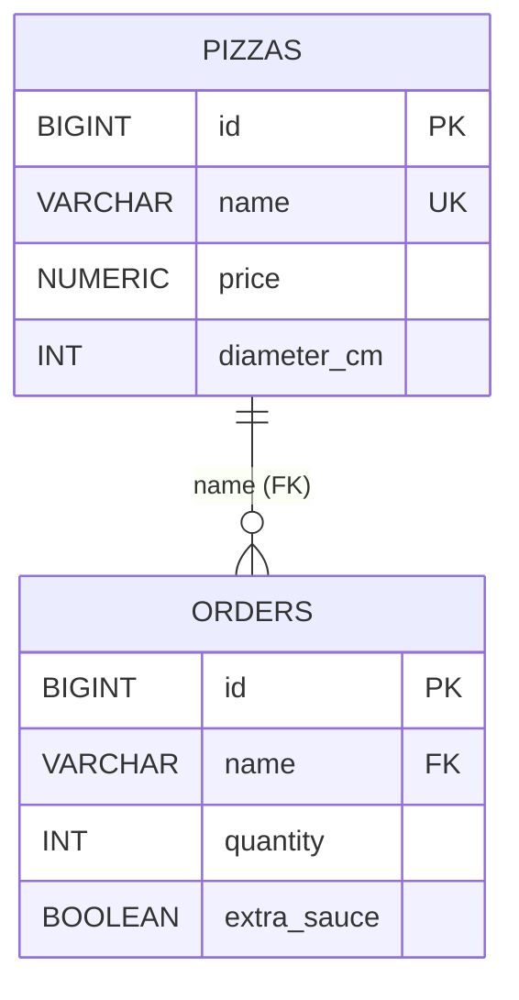

# Лабораторна робота №1: Консольний застосунок на Java

Предметна область: електронне меню піцерії.

## Опис сутностей

- Піца: назва (`String`), ціна за одиницю (`double`), діаметр у см (`int`).
- Замовлення: кількість штук (`int`), наявність додаткового соусу (`boolean`).

## Обчислювальна операція

- Додатковий соус: якщо `includesSauce == true`, додається 25 грн за кожну піцу.
- Знижка 15% надається при замовленні від 3 піц або загальній сумі від 600 грн.
- Знижка 5% надається при замовленні 2 піц.

## Інструкція запуску

```bash
mvn compile
mvn exec:java -Dexec.mainClass=ua.edu.pizzeria.Main
```

## Лабораторна робота №2: Опрацювання масивів із застосуванням циклів

Клас `PizzaOrder` моделює замовлення піци: назву, ціну за одиницю, кількість, діаметр і наявність додаткового соусу. Для кожного замовлення обчислюється сума з урахуванням соусу та знижки.

Програма заповнює масив замовлень із клавіатури, виводить його циклом for-each, рахує замовлення з ціною нижче вказаного порога, сортує за ціною методом bubble sort і виконує лінійний пошук за всіма полями об'єкта.

### Запуск ЛР2

```bash
mvn compile
mvn exec:java -Dexec.mainClass=ua.edu.pizzeria.Main
```

## Лабораторна робота №3: Обробка винятків

Класи розміщені в окремих файлах: `Main.java` відповідає за консольний сценарій, `PizzaOrder.java` — за модель замовлення, а `DomainException.java`, `InvalidPriceException.java` та `InvalidQuantityException.java` — за ієрархію доменних винятків.

Клас `PizzaOrder` перевіряє, що ціна є додатною та скінченною, а кількість піц — більшою за нуль. Для порушень створені винятки `InvalidPriceException` та `InvalidQuantityException`, що успадковуються від `DomainException` і зберігають некоректне значення.

### Запуск ЛР3

```bash
mvn compile
mvn exec:java -Dexec.mainClass=ua.edu.pizzeria.Main
```

## Лабораторна робота №4: Інтерфейси та патерн Strategy

Для замовлень піцерії поведінку розрахунку вартості винесено в інтерфейс `OrderPricingStrategy`. `StandardOrderPricingStrategy` зберігає звичні правила знижок, а `HappyHourPricingStrategy` застосовує знижку 10%. Масив стратегій демонструє поліморфне виконання; `OrderCheckout` приймає стратегію та дозволяє змінити її під час роботи програми.

`AbstractOrderPricingStrategy` частково реалізує контракт і надає спільні методи обчислення суми та знижки. `HappyHourPricingStrategy` додатково реалізує інтерфейс `PromotionDescription`, щоб окремо надавати опис акції. У `OrderPricingStrategy` є default-метод із назвою за замовчуванням.

### Запуск ЛР4

```bash
mvn compile
mvn exec:java -Dexec.mainClass=ua.edu.pizzeria.Main
```

## Лабораторна робота №5: GoF-патерни Factory Method, Observer та Adapter

- `OrderPricingStrategyFactory` створює стандартну або акційну стратегію за кодом.
- `PizzaOrder` є суб'єктом Observer: при зміні статусу він повідомляє підписані `OrderStatusListener`. У демонстрації на одне замовлення підписані журнал (`OrderStatusLogger`) і кухонний дисплей.
- `KitchenDisplayAdapter` адаптує події очікуваного інтерфейсу `OrderStatusListener` до API `LegacyKitchenDisplay`, який приймає назву замовлення і текст статусу окремими аргументами.

### Запуск ЛР5

```bash
mvn compile
mvn exec:java -Dexec.mainClass=ua.edu.pizzeria.Main
```

## Лабораторна робота №6: Наслідування та поліморфізм

Модель замовлення розширено за предметною областю: замовлення може бути самовивозом, звичайною доставкою або експрес-доставкою. Це відношення «is-a»: `PickupOrder` і `DeliveryOrder` є різновидами `PizzaOrder`, а `ExpressDeliveryOrder` є різновидом `DeliveryOrder`. `PizzaOrder` — абстрактний `sealed`-клас, який дозволяє лише `PickupOrder` та `DeliveryOrder`; останній теж `sealed` і дозволяє лише `ExpressDeliveryOrder`.

### Запуск ЛР6

Потрібен JDK 21 або новіший.

```bash
mvn compile
mvn exec:java -Dexec.mainClass=ua.edu.pizzeria.Main
```

## Лабораторна робота №7–9: Генеральний CRUD та сховище в пам'яті

Створено інтерфейс `CRUDService<T extends BaseEntity>` з реалізацією `InMemoryCrudService<T>` (колекції), спеціалізовані сервіси `PizzaService`, `OrderService`, `PizzaOrderService` та їх in-memory-реалізації. `BaseEntity` містить незмінні `id` та `name`; `equals`/`hashCode` побудовані за `id`.

### Запуск ЛР7–9

```bash
mvn compile
mvn exec:java -Dexec.mainClass=ua.edu.pizzeria.Main
```

## Лабораторна робота №10: Maven + JDBC

Проєкт перетворено на Maven-проєкт зі стандартною структурою (`src/main/java`, `src/main/resources`). Усі класи переміщені в пакет `ua.edu.pizzeria`. Сховище в пам'ять не видалено — поруч з'явилася JDBC-реалізація тих самих інтерфейсів.

### Запуск з нуля

Потрібні **JDK 21+** і **Maven 3.9+** (у репозиторії є Maven Wrapper: `mvnw.cmd` / `./mvnw`). Окремо встановлювати H2 не потрібно — драйвер підтягується Maven-ом.

```bash
# Зібрати проєкт
mvn compile

# Запустити демонстрацію ЛР №10 (JdbcDemo)
mvn exec:java

# Запустити старий інтерактивний сценарій ЛР №1–9
mvn exec:java -Dexec.mainClass=ua.edu.pizzeria.Main

# Зібрати виконуваний jar із залежностями
mvn package
java -jar target/pizzeria-system-1.0.0.jar
```

Під час першого запуску H2 створює файл `data/pizzeria.mv.db`, а `DatabaseInitializer` виконує `init.sql`. Щоб почати з чистої БД, зупиніть програму й видаліть каталог `data/`.

Параметри підключення не зашиті в код і знаходяться у `src/main/resources/application.properties`:

```properties
db.url=jdbc:h2:file:./data/pizzeria;DB_CLOSE_ON_EXIT=FALSE
db.username=sa
db.password=
db.driver=org.h2.Driver
db.pool.maximumPoolSize=10
```

### Сутності та схема БД (ЛР10)

Обрано **H2 у файловому режимі**. Зв'язок «один до багатьох»: одна піца з меню може бути в багатьох замовленнях. У наявній моделі `Order` немає окремого `pizzaId`, тому назва піци виступає природним зовнішнім ключем (`orders.name -> pizzas.name`).



| Таблиця | Поле | Обмеження |
|---|---|---|
| `pizzas` | `id` | `PRIMARY KEY` |
| `pizzas` | `name` | `NOT NULL`, `UNIQUE` |
| `pizzas` | `price` | `NUMERIC(10,2)`, `CHECK (price > 0)` |
| `pizzas` | `diameter_cm` | `NOT NULL`, `CHECK (diameter_cm > 0)` |
| `orders` | `id` | `PRIMARY KEY` |
| `orders` | `name` | `NOT NULL`, `FK -> pizzas(name)` |
| `orders` | `quantity` | `NOT NULL`, `CHECK (quantity > 0)` |
| `orders` | `extra_sauce` | `NOT NULL` |

**`ON DELETE RESTRICT`** обрано свідомо: не можна видалити піцу з меню, поки на неї посилаються замовлення. Інакше історія замовлень втратила б сенс.

### Рівень 1 — Maven + JDBC + CRUD

- `pom.xml`: `groupId=ua.edu.pizzeria`, `artifactId=pizzeria-system`, `version=1.0.0`, `maven.compiler.release=21`, `UTF-8`.
- Залежності: `com.h2database:h2`, `com.zaxxer:HikariCP`, `slf4j-api` + `slf4j-simple`.
- `JdbcPizzaService implements PizzaService`: `findById`, `findAll`, `save`, `deleteById`, `findAllSorted`, `findAllSortedByNameAndByPrice`.
- `DBConnection` — Singleton над `HikariDataSource`; параметри у `application.properties`.
- Усі записи — тільки `PreparedStatement` + try-with-resources; `findById` кидає `EntityNotFoundException`.
- `init.sql` ідемпотентний (`CREATE TABLE IF NOT EXISTS`, `MERGE ... KEY`).

### Рівень 2 — Зв'язані сутності, транзакції, ініціалізація

- `JdbcOrderService` з таблицею `orders` і сортуванням через `ORDER BY name, quantity`.
- `DatabaseInitializer` виконує `init.sql` при старті (ідемпотентно).
- `JdbcOrderPlacementService.createPizzaWithOrder` — транзакція на дві таблиці (`setAutoCommit(false)`, `commit`, `rollback`) з демонстрацією відкату.
- Порівняння SQL-ін'єкції (`PreparedStatement` безпечний; небезпечний варіант лише в README).
- ER-діаграма та інструкція запуску — вище.

### Рівень 3 — Узагальнення та пул з'єднань

- `AbstractJdbcCrudService<T>` за патерном Template Method; `JdbcOrderService` реалізовано через нього.
- Один спільний `Connection` — проблема (багатопотоковість, транзакції різних клієнтів, розрив з'єднання); `DBConnection` тримає `DataSource` (HikariCP pool).
- Пакетна вставка `addBatch`/`executeBatch` (~4,5–5,7× швидше на 1000 рядків).
- Пагінація `LIMIT/OFFSET`; `findAll()` без обмежень небезпечний на великій таблиці.

---

# Лабораторна робота №11: Робота з БД через Hibernate ORM (Jakarta Persistence)

Гілка: **`lr11/hibernate-orm`**. Pull Request створюється в `main` і **не зливається**.

У цій роботі додано **третю реалізацію** тих самих інтерфейсів `CRUDService` / `PizzaService` / `OrderService` — на Hibernate ORM. Клієнтський код не змінюється; змінюється лише обрана реалізація сервісу. Схема БД залишається тією, що створена в ЛР №10 (`init.sql`); Hibernate її лише перевіряє (`hibernate.hbm2ddl.auto=validate`).

### Запуск демонстрації ЛР №11

```bash
mvn compile
mvn exec:java
```

За замовчуванням `exec.mainClass=ua.edu.pizzeria.HibernateDemo`. Можна також запустити стару точку входу:

```bash
mvn exec:java -Dexec.mainClass=ua.edu.pizzeria.Main
```

## Сутності та відображення

Спільні поля (`id`, `name`) винесені у `@MappedSuperclass BaseEntity` (як у ЛР №7):

```java
@MappedSuperclass
public abstract class BaseEntity {
    @Id
    @GeneratedValue(strategy = GenerationType.IDENTITY)
    @Column(name = "id", nullable = false)
    private long id;

    @Column(name = "name", nullable = false, length = 120)
    private String name;
    // getters / setters / equals / hashCode за бізнес-ключем (name)
}
```

**`Pizza`** (`@Entity @Table(name="pizzas")`) — не final, має конструктор без параметрів, обмеження колонок відповідають `init.sql` (`price` як `BigDecimal` для `NUMERIC(10,2)`):

```java
@Entity
@Table(name = "pizzas")
public class Pizza extends BaseEntity {
    @Column(name = "price", nullable = false, precision = 10)
    private BigDecimal price;
    @Column(name = "diameter_cm", nullable = false)
    private int diameterCm;

    @OneToMany(mappedBy = "pizza", fetch = FetchType.LAZY,
               cascade = CascadeType.ALL, orphanRemoval = true)
    private List<Order> orders = new ArrayList<>();

    public void addOrder(Order order) { ... } // узгоджує обидві сторони
    public void removeOrder(Order order) { ... }
}
```

**`Order`** (`@Entity @Table(name="orders")`) — власник зв'язку «один до багатьох»:

```java
@Entity
@Table(name = "orders")
@AttributeOverride(name = "name",
    column = @Column(name = "name", nullable = false, length = 120, insertable = false, updatable = false))
public class Order extends BaseEntity {
    @Column(name = "quantity", nullable = false)
    private int quantity;
    @Column(name = "extra_sauce", nullable = false)
    private boolean extraSauce;

    @ManyToOne(fetch = FetchType.LAZY)
    @JoinColumn(name = "name", referencedColumnName = "name", nullable = false)
    private Pizza pizza;
}
```

**Власником зв'язку є бік `Order`**, бо стовпець-зовнішній ключ `orders.name` належить таблиці `orders`. Інверсний бік (`Pizza.orders`) позначено `mappedBy = "pizza"`.

Допоміжні методи `addOrder` / `removeOrder` підтримують обидві сторони зв'язку узгодженими (додають/прибирають замовлення з колекції піци й встановлюють/очищають посилання на піцу у замовленні).

**Стратегія завантаження:** `LAZY` для `@OneToMany` і `@ManyToOne` — завантажує пов'язані об'єкти лише при першому доступі, уникając зайвих запитів.

**Cascade / orphanRemoval:** `CascadeType.ALL` + `orphanRemoval = true` на `Pizza.orders`. ОбҰнтування: при видаленні піци її замовлення теж вилучаються (замовлення без піци не мають сенсу, а зв'язок через `name` не може бути `NULL` без порушення `NOT NULL` у `orders`).

## persistence.xml

Один persistence-unit `pizzeria-pu` у `src/main/resources/META-INF/persistence.xml`:
- `hibernate.show_sql=true`, `hibernate.format_sql=true` — вивід SQL у консоль.
- `hibernate.hbm2ddl.auto=validate` — Hibernate лише перевіряє відповідність сутностей схемі, створеній `init.sql`.
- Параметри підключення (H2, `sa` без паролю) і діалект `H2Dialect`.

## JpaUtil (Singleton)

Створює `EntityManagerFactory` один раз (статичне ініціалізування). Надає методи:
- `inTransaction(action)` — `EntityManager` на кожну операцію, `begin` → дія → `commit`, при помилці — `rollback`, `EM` закривається в `finally`.
- `readOnly(action)` — читання без транзакції; `EM` закривається після виходу.

`EntityManager` створюється на кожну операцію й закривається після неї — це уникає проблем із закритим контекстом persistence.

## Сервіси на Hibernate

- `HibernatePizzaService implements PizzaService` — `findById`, `save` (додавання або оновлення за `id`), `delete`, `findAllSortedByName`, `findAllSortedByNameAndByPrice` (JPQL `ORDER BY`), `findByName` (іменований параметр), `findPage` (`setFirstResult`/`setMaxResults`).
- `HibernateOrderService implements OrderService` — аналогічно для `Order`, плюс `findByPizzaName` (іменований параметр) та пагінація.
- `findById` / `delete` кидають `EntityNotFoundException` з ЛР №7, якщо запису немає.

## Рівень 3 — JPQL

Всі запити використовують іменовані параметри (без склеювання рядків):

- `findAllSortedByNameAndByPrice()` → `SELECT p FROM Pizza p ORDER BY p.name, p.price`
- `findAllSortedByNameAndByQuantity()` → `SELECT o FROM Order o ORDER BY o.name, o.quantity`
- `findByName(String name)` → `WHERE p.name = :name`
- `findByPizzaName(String pizzaName)` → `WHERE o.pizza.name = :pizzaName`
- `findPage(offset, limit)` → `setFirstResult(offset)`, `setMaxResults(limit)`

## Проблеми та їх виправлення (демонструються у `HibernateDemo`)

**1. `LazyInitializationException`.** Доступ до лінивої колекції `Pizza.orders` або проксі `Order.pizza` після закриття `EntityManager` кидає `org.hibernate.LazyInitializationException`. Демонстрація ловить виняток, а потім виправлення — працювати зі зв'язком всередині відкритого `EntityManager` (`JpaUtil.inTransaction` / `readOnly`).

**2. Проблема N+1.** Завантаження списку замовлень (1 запит) і обхід `getPizza()` у циклі призведе до ще одного запиту на кожне замовлення (N+1 загалом). Виправлення — `JOIN FETCH`:

```sql
SELECT o FROM Order o JOIN FETCH o.pizza
```

— 1 запит замість N+1. У демонстрації виводиться кількість SQL-запитів до й після виправлення.

## Показ помилки валідації схеми

Клас `HibernateValidateDemo` створює `EntityManagerFactory` зі сутністю `PizzaMismatch`, у які є поле `phone`, якого немає в таблиці `pizzas`. Przy `hibernate.hbm2ddl.auto=validate` Hibernate кидає `SchemaManagementException` ще на етапі створення фабрики — показується, що Hibernate скаржиться на розбіжність між сутністю й таблицею.

## Перевірка

- `mvn clean compile` — успіх (49+ джерел).
- `mvn exec:java` — повний цикл: створення → читання → оновлення → видалення, зв'язки Pizza/Order, JPQL-запити, LazyInitializationException та його виправлення, N+1 та JOIN FETCH.
- `mvn exec:java -Dexec.mainClass=ua.edu.pizzeria.HibernateValidateDemo` — очікувана помилка валідації сховища.
- Попередні лабораторні (`Main`) все ще працюють без змін у клієнтському коді.
